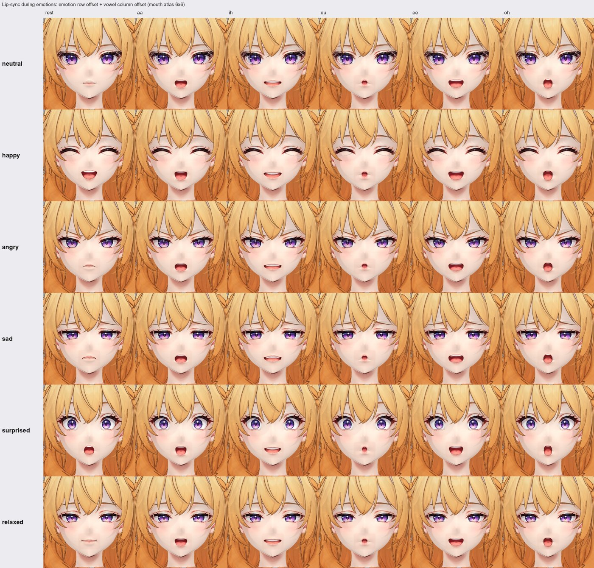

# vrm-face-atlas-expressions

VRM 1.0 アバターの **表情・口パク・まばたき** を「1つの頭＋目と口のテクスチャアトラス切り替え」で作るための
Claude Code 用 Skill です。生成AI（Tripo など）で作った「目や口が絵として描かれた頭」でも、
VRM 1.0 標準の TextureTransformBind だけで、口パク・まばたき・ウインク・感情（喜怒哀楽）と
**感情中の口パク**（笑いながら喋る）が動きます。



## 中身

```
skills/vrm-face-atlas-expressions/
  SKILL.md                         手順と考え方（日本語）
  scripts/
    face_atlas_config.example.json 表情・タイル配置の設定例
    setup_face_atlas_bindings.py   Blender: 顔マテリアルの MToon 統一 + VRM 表情（Morph + TextureTransform）を作成
    pack_atlas.py                  表情タイルをアトラスに並べる（余白・色のにじみ付き、ミップマップ対策）
    render_combo_check.py          Blender: 感情×母音・まばたきの全組み合わせを描画
    make_grid.py                   上の描画結果を一覧画像にまとめる
    slim_glb.py                    書き出し後の .vrm を修正・軽量化（emissive 0 / matcap 0 / ミップマップ / sparse / 1byte ウェイト）
    vrm_face_guard.js              three-vrm 用: 「母音1つ＋感情1つ」に制限 + 自然なまばたき + 見返り追従のなめらか化
  examples/                        アトラス・組み合わせ一覧・修正前後の例
```

## 導入

1. このリポジトリの `skills/vrm-face-atlas-expressions` フォルダを、使いたいプロジェクトの `.claude/skills/` にコピーします
   （全プロジェクトで使うなら `~/.claude/skills/`）。
2. Claude Code で「VRM に表情をつけたい」「口パクをアトラスで」などと話しかけると、この Skill が読み込まれます。
   スクリプトは単体でも使えます（各ファイル先頭に使い方）。

## 動作環境

- Blender 4.x / 5.x（5.2 で確認）
- VRM Add-on for Blender（4.7 系で確認）
- Python 3.10+ と numpy / scipy / Pillow（`pack_atlas.py`, `make_grid.py`, `slim_glb.py`）
- three.js 用ガード: @pixiv/three-vrm v3.4.x で確認

## 注意

- アトラスのオフセットは VRM では **足し算** です。同時に効かせるのは「母音1つ＋感情1つ」まで（詳しくは SKILL.md §5・§6）。

## ライセンス

- スクリプトと手順（SKILL.md）は **MIT License**（`LICENSE`）。自由に使ってください。
- `examples/` の画像のキャラクターは AIネクタリカ です。画像だけはライセンスの対象外です（再配布・改変利用はご遠慮ください）。
